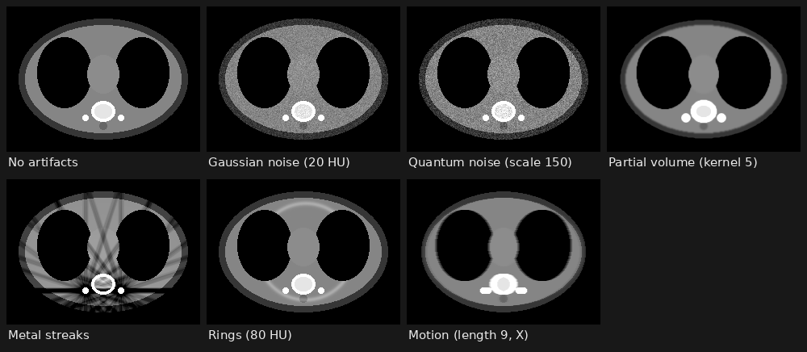
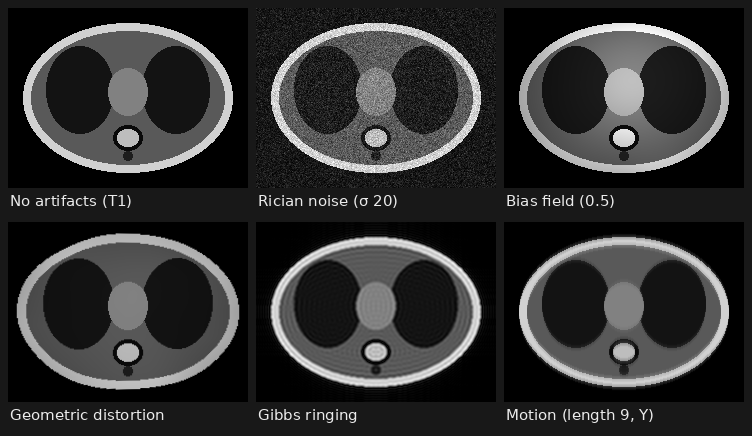
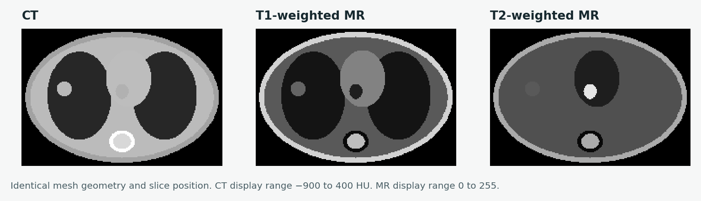
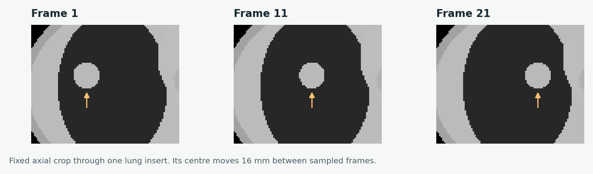
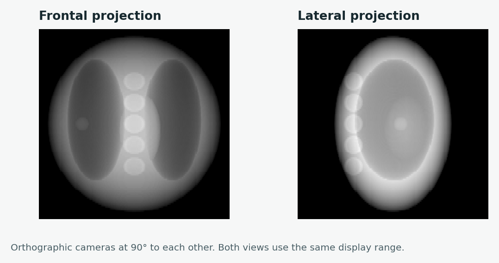
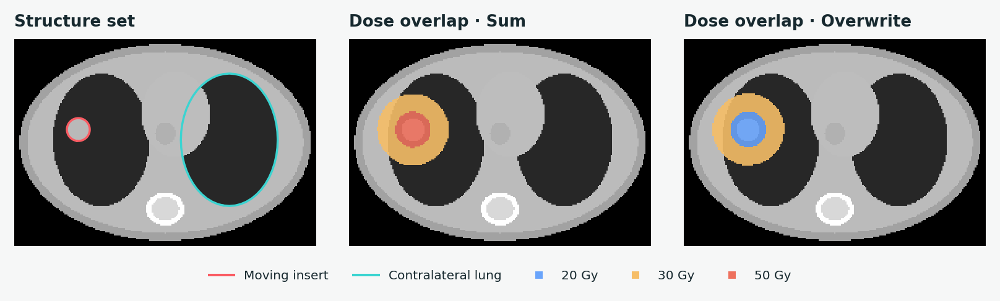

# DICOMator

<p align="center">
  
</p>

Blender add-on that converts selected mesh objects into DICOM outputs for synthetic CT/MR image series, camera-based digitally reconstructed radiographs (DRRs), RT Dose grids, and RT Structure Sets. It voxelizes the active mesh selection directly into modality-appropriate intensities, supports single-phase or 4D acquisitions, and layers in synthetic artifacts tailored to the chosen modality for training or visualization workflows.

> [!WARNING]
> DICOMator produces synthetic research, education, and visualization data. It is not a medical device, is not validated for clinical diagnosis or treatment, and must not be imported into a clinical workflow as patient-acquired data. Every generated SOP instance is marked `SyntheticData = YES`.

## Contents

- [Examples](#examples)
- [Setup](#setup)
- [Quick start: your first CT series](#quick-start-your-first-ct-series)
- [The DICOMator sidebar](#the-dicomator-sidebar)
- [Step-by-step workflows](#step-by-step-workflows)
- [Checking the export](#checking-the-export)
- [Features](#features)
- [Output details](#output-details)
- [Performance and limits](#performance-and-limits)
- [Known limitations](#known-limitations)
- [Troubleshooting](#troubleshooting)
- [Repository layout](#repository-layout)
- [Development and testing](#development-and-testing)

## Examples

Sample outputs produced by the add-on. The [step-by-step workflows](#step-by-step-workflows) also show the same mesh phantom exported with different material presets, animation frames, camera angles and dose overlap settings.

<table>
  <tr>
    <td align="center">
      
      <br /><sub>Synthetic CT series (skull)</sub>
    </td>
    <td align="center">
      
      <br /><sub>Synthetic CT series (lung)</sub>
    </td>
    <td align="center">
      
      <br /><sub>Camera-based DRR (Suzanne)</sub>
    </td>
  </tr>
</table>

The artifact generators, applied one at a time to a numerical thorax phantom (soft tissue, lung, spine and, for CT, two titanium screws). Each tile is a slice that was written by the add-on's DICOM writer and read back with pydicom; `docs/make_artifact_figures.py` regenerates both figures.

<p align="center">
  
  <br /><sub>CT artifacts (window centre 40 HU, width 400 HU)</sub>
</p>

<p align="center">
  
  <br /><sub>T1 MR artifacts (window centre 128, width 256)</sub>
</p>

## Setup

### What you need

- **Blender 5.1 or newer** (Windows, macOS or Linux). Blender ships the Python 3.13 runtime and NumPy that DICOMator uses.
- Nothing else. pydicom 3.0.2 is bundled inside the extension as an unmodified wheel and Blender installs it for you; you never touch Blender's Python environment.

### Install the extension

**From the Blender Extensions platform** (once DICOMator is listed there):

1. Open **Edit → Preferences → Get Extensions** (on macOS: **Blender → Settings**).
2. Search for **DICOMator**.
3. Select **Install**.

**From a release zip:**

1. Download `dicomator-<version>.zip` from the [Releases page](https://github.com/drmichaeldouglass/DICOMator/releases). Do not unzip it. Every published release is packaged and validated by Blender itself in CI, so the archive is the one Blender's own extension tooling produces.
2. In Blender, open **Edit → Preferences → Get Extensions**.
3. Open the drop-down arrow at the top right of the window and choose **Install from Disk...**.
4. Select the downloaded zip. You can also drag the zip into the Blender window.

**From source** (development or pre-release build):

1. Build the extension from the repository root:

   ```bash
   blender --command extension validate
   blender --command extension build --output-filepath dicomator.zip
   ```

2. Install `dicomator.zip` with **Install from Disk...** as above.

GitHub's green **Code → Download ZIP** button is *not* an installable package: it contains the tests and development files and has not been through Blender's validator. Use a release zip or build one.

### Check that it is installed

1. In **Edit → Preferences → Add-ons**, search for **DICOMator** and confirm it is ticked.
2. In the 3D Viewport, press **N** to open the sidebar and look for the **DICOMator** tab.
3. The panel must not show *pydicom unavailable*. If it does, remove and reinstall the extension (see [Troubleshooting](#troubleshooting)).

### Prepare the scene

DICOMator turns Blender geometry into patient geometry with two fixed rules, so set these up before modelling:

| Rule | What to do |
| --- | --- |
| **One Blender unit is one metre.** | Keep **Scene Properties → Units → Unit Scale** at `1.0` (export is blocked otherwise) and model at real size: a 30 cm phantom is `0.3` units wide. Blender's default 2 m cube needs about a billion 2 mm voxels and is refused as too large. |
| **World axes are patient axes.** | `+X` is patient left, `+Y` is posterior, `+Z` is superior. A head-first supine patient lies with the head towards `+Z` and the face towards `-Y`. |

Imported meshes are the usual source of scale mistakes. STL, OBJ and PLY files from scanners, segmentation tools and 3D-printing workflows are normally in millimetres, so set the import **Scale** to `0.001` (or scale the object by `0.001` afterwards and apply it with **Object → Apply → Scale**). The **Estimate** sub-panel shows the selection size in metres, which is the quickest way to spot a phantom that is 1000 times too big.

Meshes should be closed (watertight) surfaces. Open or non-manifold meshes still export, with a warning, but may fill incorrectly.

## Quick start: your first CT series

This takes about a minute and uses only the default **Basic** mode.

1. **Make something to scan.** Delete the default cube, then **Add → Mesh → UV Sphere** and set its **Radius** to `0.1` m in the *Add UV Sphere* box at the bottom left of the viewport. This is a 20 cm ball.
2. **Open the panel.** With the sphere selected, press **N** and choose the **DICOMator** tab.
3. **Give it a tissue.** In **Objects**, leave **Material Presets** on **CT** and set the sphere's **Material** to **Soft Tissue**. The **HU** field changes to `40`.
4. **Choose where to write.** In **Export**, the **Export Directory** defaults to `//DICOM_Export`: a `DICOM_Export` folder beside your saved `.blend` file, or in your home folder if the file has not been saved yet. The resolved path is printed underneath. The folder must be new or empty.
5. **Export.** Click **Export DICOM** at the top of the panel. A progress bar runs in the status bar and **ESC** cancels.

The result is 102 files, `CT_Slice_0001.dcm` to `CT_Slice_0102.dcm`, forming a 102 x 102 x 102 volume of 2 mm voxels: a +40 HU sphere in -1000 HU air. Open the folder in any DICOM viewer (see [Checking the export](#checking-the-export)).

From here, add more meshes with different materials (a smaller **Cortical Bone** sphere inside the first one, for example), select them all, and export again into a new folder. Every *selected* mesh is exported; unselected ones are ignored.

## The DICOMator sidebar

Everything lives in the 3D Viewport sidebar (**N**) under the **DICOMator** tab. The layout below is Advanced mode with DRR enabled; Basic mode shows a subset.

```text
┌ DICOMator ───────────────────────────────────────┐
│ [ Basic | Intermediate | Advanced ]              │  interface mode
│ ⚠ Synthetic research data only - not clinical    │
│ Image 3 | Dose 1 | Struct 2                      │  selected meshes by role
│ ☑ Image   ☑ DRR   ☑ Dose   ☑ Structures          │  outputs (Advanced)
│ [            Export DICOM            ]           │  or the reason it is blocked
├ ▼ Objects ───────────────────────────────────────┤
│ Material Presets   [ CT ▾ ]                      │  CT, T1 MR or T2 MR
│ Body                                             │  one block per selected mesh
│   DICOM Type       [ Image ▾ ]                   │  Image / RT Dose / RT Structure
│   Material [ Soft Tissue ▾ ]   HU [ 40 ]         │
│   Overlap Priority [ 0 ]                         │
├ ▼ Export ────────────────────────────────────────┤
│ Lateral (mm) [ 2.00 ]   Axial (mm) [ 2.00 ]      │  voxel size
│ DRR Resolution Scale, Water Attenuation (1/m)    │  when DRR is enabled
│ ☑ Apply Modifiers   ☐ Allow Oversized Grids      │
│ Export Directory   [ //DICOM_Export ]            │
│ ☐ Export 4D/Time Series                          │
│ Dose Type, Summation Type, Dose Overlap          │  when a dose mesh is selected
│   ▶ Artifacts                                    │  noise, streaks, rings, motion...
├ ▶ Series ────────────────────────────────────────┤  patient and study metadata
├ ▶ Estimate ──────────────────────────────────────┤  grid size and memory
└──────────────────────────────────────────────────┘
```

### Interface modes

The **Mode** selector decides how much of the add-on is shown *and applied*. A setting hidden by the current mode keeps its value but does nothing; anything switched on and currently inactive is listed under the selector and repeated as a warning when the export starts.

| | Basic | Intermediate | Advanced |
| --- | :---: | :---: | :---: |
| CT / MR image series, material presets, voxel size, patient metadata | ✔ | ✔ | ✔ |
| Artifacts sub-panel | | ✔ | ✔ |
| 4D / time-series export | | ✔ | ✔ |
| Per-object overlap priority | | ✔ | ✔ |
| Output checkboxes (Image, DRR, Dose, Structures) | | | ✔ |
| Per-object DICOM Type and ROI Type | | | ✔ |
| DRR and RT Dose settings | | | ✔ |
| Allow Oversized Grids | | | ✔ |

Basic and Intermediate always write exactly one image series. In Basic mode overlapping image meshes are resolved by name (stored priorities are ignored and flagged in the Objects panel).

### Main panel

- **Selection summary** – how many selected meshes are Image, Dose and Structure meshes.
- **Output checkboxes** (Advanced) – **Image** writes CT or MR slices from Image meshes, **DRR** a camera projection of the same meshes, **Dose** an RT Dose grid from RT Dose meshes, and **Structures** an RT Structure Set from RT Structure meshes.
- **Export DICOM** – when the export cannot run, the button is replaced by the reason:

| Message | Meaning |
| --- | --- |
| *Select a mesh* | The active object is not a mesh, or no mesh is selected |
| *Choose a new or empty export folder* | The export folder already contains files |
| *Scene Unit Scale must be 1.0* | See [Prepare the scene](#prepare-the-scene) |
| *No image / dose / structure mesh selected* | An enabled output has no mesh of the matching DICOM Type |
| *Set an active scene camera for DRR export* | DRR is enabled and the scene has no camera |
| *pydicom unavailable* | The bundled dependency did not install; reinstall the extension |

The button is greyed out in Edit Mode and while another export is running. A grid-size warning in the sidebar uses the current frame’s bounding boxes. Export checks the actual mesh bounds across the requested frames before allocating the grid.

### Objects

- **Material Presets** – CT, T1 MR or T2 MR. This one selector sets the preset intensities *and* whether the series is written as CT or MR. Changing it re-applies the preset of every mesh in the scene.
- For each selected mesh:
  - **DICOM Type** (Advanced) – *Image*, *RT Dose* or *RT Structure*. A mesh feeds exactly one output; duplicate it to use the same shape twice (for example a tumour that is both imaged and contoured).
  - *Image* meshes: **Material** picks one of eighteen tissue presets (see the [table](#features)); **Custom** leaves the **HU** field for you to type. **Overlap Priority** (Intermediate and Advanced) decides which mesh wins where meshes overlap: the highest value wins, and names break ties. A typical nested phantom gives the body `0`, organs `1` and inserts inside organs `2`.
  - *RT Dose* meshes: **Dose (Gy)** assigned to every voxel inside the mesh, plus an overlap priority used when **Dose Overlap** is *Overwrite*.
  - *RT Structure* meshes: **ROI Type** (GTV, CTV, PTV, OAR, External, ...). The ROI name is the object name and the ROI colour is the object's first material colour.

### Export

- **Lateral (mm)** / **Axial (mm)** – in-plane pixel size and slice spacing, 0.1 to 10 mm.
- **Apply Modifiers** – voxelize the mesh as displayed (modifiers, shape keys, armatures). Switch it off to use the base mesh.
- **Allow Oversized Grids** (Advanced) – bypass the [size guardrails](#performance-and-limits) at your own risk.
- **Export Directory** – a new or empty folder. `//` means "beside the `.blend` file"; for an unsaved file it means your home folder. The resolved absolute path is shown.
- **Export 4D/Time Series** (Intermediate and Advanced) – export one series per animation frame, over the timeline range or a custom **Start** / **End** / **Frame Step**.
- **DRR Resolution Scale** and **Water Attenuation (1/m)** – shown when DRR is enabled, with the camera and detector size that will be used.
- **Dose Type**, **Summation Type**, **Dose Overlap** – shown in Advanced mode when a dose mesh is selected.
- **Artifacts** (Intermediate and Advanced, collapsed by default) – an **Artifact Seed** for reproducibility and one box per artifact. The list follows the modality: CT offers Gaussian noise, partial volume, metal streaks, rings, quantum noise and motion; MR offers Rician noise, bias field, geometric distortion, Gibbs ringing and motion. Artifacts affect the image series only.

### Series

Series description, patient name, MRN, birth date (`YYYYMMDD`), sex, patient position (HFS, FFS, ...), study ID and accession number. These are written to every exported object.

### Estimate

Selection size in metres, estimated grid dimensions, voxel count, a conservative peak-memory figure, and the DRR detector size. Check this before a large export.

## Step-by-step workflows

Each recipe starts from meshes that are already modelled at real size and selected.

### CT with artifacts

1. Set **Mode** to **Intermediate**.
2. In **Objects**, assign a material to each mesh and, where meshes overlap, give the inner ones a higher **Overlap Priority**.
3. Open **Export → Artifacts** and tick the artifacts you want. Good starting points are the defaults: Gaussian 20 HU, partial volume kernel 3, quantum noise scale 150.
4. For **Metal Streaks** the scene needs a mesh above the **Metal Threshold** (2000 HU by default): assign **Titanium (implant)** or **Aluminium** to it.
5. Note the **Artifact Seed**. The same seed and settings reproduce the same images.
6. Click **Export DICOM**.

### MR series

1. In **Objects**, set **Material Presets** to **T1 MR** or **T2 MR**. Every preset mesh switches to its MR intensity and the export becomes an MR series (background 0 instead of -1000).
2. Meshes on **Custom** keep their typed value, so re-enter those as MR intensities (0 to about 250). A negative value left over from CT is exported as 0 (signal void), with a warning naming the mesh.
3. Optionally, in Intermediate mode, enable the MR artifacts (Rician noise, bias field, geometric distortion, Gibbs ringing, motion).
4. Export.



The small central fluid insert illustrates the preset change. It appears dark on T1 and bright on T2.

### 4D (time-resolved) series

1. Animate the meshes: keyframed transforms, shape keys, armatures or any modifier animation (a breathing lung, a moving tumour). Keep **Apply Modifiers** ticked for anything other than plain object transforms.
2. Set **Mode** to **Intermediate** and tick **Export → Export 4D/Time Series**.
3. Either use the timeline range or untick **Use Timeline Range** and enter **Start**, **End** and **Frame Step**. Ten phases from a 100-frame breathing cycle is Start `1`, End `100`, Step `10`.
4. Export. The timeline visibly steps through the frames. Each phase is written as its own series (`Phase_001_CT_Slice_0001.dcm`, ...) on one fixed grid that covers the motion at every frame, labelled *Phase 1 (0.0%)*, *Phase 2 (10.0%)*, and so on.



### DRR (digitally reconstructed radiograph)

1. Add a camera (**Add → Camera**) and aim it at the phantom; **View → Cameras → Active Camera** (`Numpad 0`) shows what the detector sees. Make sure it is the scene camera (**Scene Properties → Camera**).
2. In **Camera Properties → Lens**, set **Type** to **Orthographic** for a parallel-beam projection with full patient-space geometry tags. A perspective camera gives a diverging-beam image but its pixel spacing and position tags are omitted.
3. Set the detector size with **Output Properties → Resolution** (for example 512 x 512 at 100%).
4. Set **Mode** to **Advanced** and tick **DRR** (untick **Image** if you only want the radiograph).
5. In **Export**, leave **Water Attenuation** at `20` m⁻¹ (about 60 keV) or change it to model another beam quality, and use **DRR Resolution Scale** for a quick low-resolution test.
6. Export. The DRR is written as `DRR_Image_0001.dcm`.

For a 4D DRR with camera cuts, bind cameras to timeline markers. Each phase uses the camera active at its frame.

The DRR is a projection of the voxel grid, so its sharpness follows the voxel size, and it always uses CT numbers, even for an MR export.



### RT Dose and RT Structure Set

1. Set **Mode** to **Advanced**.
2. Model the anatomy as *Image* meshes as usual.
3. For each structure, add (or duplicate) a mesh, set its **DICOM Type** to **RT Structure**, choose the **ROI Type**, name the object as the ROI should be named, and give it a material whose colour you want for the contour.
4. For dose, add one or more meshes with **DICOM Type** **RT Dose** and a **Dose (Gy)** value. Nested meshes make a stepped dose distribution: with **Dose Overlap** on *Sum* a 30 Gy mesh containing a 20 Gy mesh gives 50 Gy in the centre; with *Overwrite* and a higher priority on the inner mesh, the centre receives the inner mesh's own value.
5. Tick **Image**, **Dose** and **Structures**, select *all* the meshes, and export.

The folder then holds the image slices plus `RTDose.dcm`, a minimal companion `RTPlan.dcm` and `RTStruct.dcm`, all in one study and one frame of reference, with the structure set referencing the image slices.



The overlays use the exported contour coordinates, dose scaling and image positions. The outer mesh contributes 30 Gy. The higher-priority inner mesh contributes 20 Gy, giving 50 Gy centrally with **Sum** and 20 Gy with **Overwrite**.

## Checking the export

Any DICOM viewer opens the result. [3D Slicer](https://www.slicer.org/) is free and reads every object type DICOMator writes: **Add DICOM Data → Import DICOM files**, then load the study (install the *SlicerRT* extension to display RT Dose and RT Structure Sets).

For a scripted check, pydicom is enough:

```python
from pathlib import Path

import numpy as np
import pydicom

slices = [pydicom.dcmread(path) for path in Path("DICOM_Export").glob("CT_Slice_*.dcm")]
slices.sort(key=lambda ds: float(ds.ImagePositionPatient[2]))
volume = np.stack([ds.pixel_array * ds.RescaleSlope + ds.RescaleIntercept for ds in slices])

print(volume.shape)                  # (slices, rows, columns)
print(volume.min(), volume.max())    # HU range
print(slices[0].PixelSpacing, slices[0].SliceThickness)
```

The data can be imported into a treatment planning system for research, teaching and commissioning-style exercises, but only into a non-clinical (research or training) database: the files are synthetic, are marked `SyntheticData = YES`, and must never be mixed with patient data.

## Features

- **Basic / Intermediate / Advanced interface modes**
  - A **Mode** selector at the top of the DICOMator panel controls how much of the interface is shown, so a simple synthetic CT dataset does not require walking past the research features
  - **Basic** – image series only: material presets and per-object intensities, voxel resolution, patient/series metadata, and the export folder
  - **Intermediate** – adds the **Artifacts** sub-panel, 4D/time-series export, and per-object overlap priority
  - **Advanced** – adds every remaining setting: output selection (Image/DRR/Dose/Structures), per-object DICOM type and ROI type, DRR and RT Dose settings, and the oversized-grid override
  - Settings a mode hides keep their stored values but are **not applied** to the export; anything switched on and currently inactive is listed in the panel and reported when the export starts. Basic mode ignores stored overlap priorities and resolves overlapping image meshes by name; non-zero inactive priorities are identified in the Objects panel.
- **Per-object DICOM type and intensities**
  - Each selected mesh is tagged as **Image**, **RT Dose**, or **RT Structure** via the Objects panel
  - Image objects: set HU/intensity value or pick a tissue preset; an explicit overlap priority controls which mesh wins
  - RT Dose objects: assign an absorbed dose value (Gy) per mesh; voxels within the mesh receive that dose
  - RT Structure objects: assign an ROI type (GTV, CTV, PTV, OAR, External, Control, Avoidance, Organ, Treated Volume, Irradiated Volume); contours are extracted at each image slice plane
- **Tissue intensity presets**
  - The **Material Presets** selector at the top of the Objects panel chooses CT, T1 MR, or T2 MR; it drives both the preset intensities and whether the image series is written as CT or MR
  - Eighteen presets cover air, lung, fat, soft tissue, abdominal organs, cartilage, blood, brain matter, CSF, bone, and metal implants (see the table below)
  - Selecting a preset populates that object's intensity automatically, while `Custom` leaves the manually entered value untouched
  - Changing the modality re-applies every preset intensity in the scene
- **Single-phase or 4D export**
  - Export the exact current animation time, including fractional frames, or a range of integer frames (timeline or custom range)
  - One `SeriesInstanceUID` per phase; phases are written as separate series with temporal DICOM tags (`NumberOfTemporalPositions`, `TemporalPositionIndex`, `TemporalPositionIdentifier`)
  - Timeline advances during 4D export and a fixed padded bounding box keeps grids aligned between phases
- **Camera-based DRR generation**
  - Enable DRR output alongside, or instead of, the image series output
  - The DRR uses a monoenergetic Beer-Lambert approximation with a configurable effective water attenuation coefficient in `m^-1`
  - Detector size follows the Blender render resolution (including the resolution percentage) with an optional DRR resolution scale
  - Orthographic cameras emit patient-space detector geometry; perspective images omit spatial tags whose detector scale would be ambiguous
- **Voxelization control**
  - Independent lateral (XY) and axial (Z) voxel size in millimetres
  - Optional evaluation of modifiers/shape keys/armatures during voxelization
  - BVH-based +Z column fill for solid voxelization with consistent grid dimensions
  - A mesh made of several closed surfaces is filled surface by surface: a surface nested inside another makes a cavity, and surfaces that merely overlap (organs joined into one object) are merged rather than cancelling each other. Faces are grouped into surfaces by vertex position, so hard-edged meshes with duplicated seam vertices (flat-shaded glTF/OBJ imports, Edge Split) still count as one closed surface; any pieces left open are filled together with even/odd pairing
  - A voxel is filled when its centre lies inside the mesh or on its surface, so a flat face that lands exactly on a plane of voxel centres fills that whole slice
  - Only the columns covering each mesh's XY footprint are ray-cast, so small meshes inside a large grid stay cheap
- **Synthetic artifact suite** (image series only)
  - The **Artifacts** sub-panel sits under **Export** and is shown in Intermediate or Advanced mode while **Image** output is enabled; artifacts never reach the DRR, RT Dose, or RT Structure outputs
  - CT applies, in order: projection-domain metal streaks (Radon forward/back-projection with photon starvation and beam hardening), detector-channel rings, partial volume (scanner point-spread, applied after the streaks so blurring cannot hide a small implant from the metal detection), motion blur, Gaussian noise, and quantum (Poisson) noise
  - Settings for the other modality (for example an MR bias field while exporting CT) stay stored but are not applied and do not count towards the memory estimate
  - MRI applies, in order: motion blur, geometric distortion (gradient non-linearity and B0 off-resonance, with signal-conserving intensity pile-up), Gibbs/truncation ringing, coil-shaped bias-field shading, and Rician noise, after which the magnitude volume is clamped to non-negative values
  - The single **Gaussian** noise toggle switches to Rician noise for the MR modalities, reusing the entered value as the per-channel standard deviation
  - A stored artifact seed makes repeated exports reproducible. Each artifact draws from its own random stream, so switching one artifact on or off never changes another's pattern; every 4D phase gets a deterministic sub-seed, except detector rings, which are a scanner property and stay identical across phases
- **Patient and orientation metadata**
  - Patient Name, MRN (Patient ID), Birth Date (YYYYMMDD), Sex, and Patient Position (HFS/FFS/HFP/FFP/HFDR/HFDL/FFDR/FFDL)
  - Study ID and Accession Number are user-editable and written to every exported object
  - UTF-8 metadata is declared explicitly, value delimiters/control characters are sanitized, and DICOM byte limits are enforced
  - Customizable Series Description per export or phase (a long description is shortened to keep the phase and output-type suffix within DICOM's 64-character limit)
  - All objects exported together share a single study timestamp, so Study/Series/Content dates and times agree across image slices, DRR, dose, plan, and structure files
- **Export path handling and progress feedback**
  - Accepts Blender-relative paths starting with `//` (resolved relative to the `.blend` file, or to your home folder while the file is unsaved)
  - Defaults to `//DICOM_Export` so a new install starts with a portable export location instead of an OS-specific absolute path
  - Exports run as a modal background job: the Blender UI stays responsive, a progress bar tracks voxelization and slice writing, and **ESC cancels** the export at any time
  - Exports are staged in a temporary sibling directory and committed only after every requested object succeeds; cancel or failure removes the partial staging directory
  - A new or empty export directory is required, preventing stale files and mixed Study/Series UIDs
  - Meshes with no faces or lying outside the grid are skipped with a warning, and evaluated meshes with non-manifold geometry or ambiguous odd ray intersections raise warnings of their own
- **RT Dose export**
  - Mesh objects tagged as RT Dose are voxelized and written as a single multi-frame DICOM RT Dose file (`RTDoseStorage`)
  - Dose values (Gy) are encoded as uint32 scaled by a `DoseGridScaling` factor computed from the peak dose in the grid
  - Overlapping dose meshes either **sum** (default) or **overwrite** using explicit overlap priority
  - Configurable `DoseType` (Physical / Effective); `DoseSummationType` is restricted to Plan until real fraction and treatment-beam geometry are implemented
  - A minimal unapproved companion RT Plan file (`RTPlanStorage`) is written and referenced via `ReferencedRTPlanSequence`
  - RT Dose, image, DRR, and RT Structure exports share the same Study Instance UID and Frame of Reference UID when enabled together
- **RT Structure Set export**
  - Mesh objects tagged as RT Structure are sliced at each image Z-plane using bmesh bisection
  - Closed planar contours are extracted from cut edges and written as a DICOM RT Structure Set (`RTStructureSetStorage`)
  - ROI display colour is read from the object's first material diffuse colour and written as it appears in the viewport, or a clinical-style palette is used as a fallback
  - Supports ROI types GTV, CTV, PTV, OAR, External, Control, Avoidance, Organ, Treated Volume, and Irradiated Volume
- **Selection insights**
  - Live estimates of grid dimensions, voxel counts, approximate peak memory usage, and DRR detector size before export

<details>
<summary><strong>Tissue preset intensities</strong></summary>

| Preset | CT (HU) | T1 MR | T2 MR |
| --- | ---: | ---: | ---: |
| Air | -1000 | 0 | 0 |
| Cortical Bone / Calcification | 1100 | 10 | 8 |
| Trabecular Bone / Fatty Marrow | 200 | 190 | 170 |
| Fat (subcutaneous, orbital) | -75 | 210 | 170 |
| Muscle | 50 | 90 | 80 |
| Liver | 50 | 100 | 90 |
| Spleen | 50 | 110 | 120 |
| Kidney Cortex | 40 | 110 | 100 |
| Kidney Medulla | 40 | 90 | 150 |
| Cartilage | 200 | 100 | 130 |
| Blood (acute, deoxyHb) | 60 | 130 | 30 |
| White Matter | 25 | 150 | 50 |
| Gray Matter | 40 | 110 | 110 |
| CSF / Water / Edema | 0 | 30 | 230 |
| Lung Parenchyma | -700 | 20 | 80 |
| Soft Tissue | 40 | 100 | 90 |
| Aluminium | 2300 | 0 | 0 |
| Titanium (implant) | 3000 | 0 | 0 |

</details>

## Blender compatibility

- Targets the Blender 5.1 Python 3.13 runtime (VFX Platform 2026); CI additionally smoke-tests registration on the current stable series.
- The add-on has **no OpenVDB dependency**. Voxelization is performed with Blender mesh evaluation, `mathutils.bvhtree.BVHTree`, and NumPy arrays.
- NumPy 2.x compatibility is maintained by using `np.asarray(...)` rather than `np.array(..., copy=False)` throughout.
- Extension packaging advertises only the vendored `pydicom 3.0.2` (`py3-none-any`) wheel, which requires Python 3.10+ and is compatible with NumPy 2.x and Python 3.13.
- Because that wheel is pure Python, the manifest declares no `platforms` list, so the extension is offered on every platform Blender ships (including the arm64 Linux and Windows builds).
- `blender_manifest.toml` is the authoritative release metadata; the add-on carries no legacy `bl_info` block.
- The built package contains only the add-on modules, the manifest, `README.md`, `LICENSE`, and the wheel; tests, CI configuration, docs assets, and developer tool caches are excluded by `paths_exclude_pattern`.

## Output details

Every enabled output is written as its own DICOM series inside a single study:

| Output | Single phase | 4D phase |
| --- | --- | --- |
| Image series | `CT_Slice_0001.dcm` / `MR_Slice_0001.dcm` … | `Phase_001_CT_Slice_0001.dcm` … |
| DRR | `DRR_Image_0001.dcm` | `Phase_001_DRR.dcm` |
| RT Dose | `RTDose.dcm` | `Phase_001_RTDose.dcm` |
| RT Plan (companion) | `RTPlan.dcm` | `Phase_001_RTPlan.dcm` |
| RT Structure Set | `RTStruct.dcm` | `Phase_001_RTStruct.dcm` |

- **Image series output**
  - Modality: CT (`CTImageStorage`) or MR (`MRImageStorage`) depending on the selected imaging modality
  - Data type: int16 signed (direct HU/intensity values)
  - Background voxels are -1000 HU (air) for CT and 0 (signal void) for MR
  - `ImageType` identifies the images as derived (`DERIVED\PRIMARY\AXIAL` for CT, `DERIVED\PRIMARY\OTHER` for MR); `SyntheticData = YES` and `SpecificCharacterSet = ISO_IR 192` are written to every slice
  - CT slices carry the rescale attributes (`RescaleIntercept = 0`, `RescaleSlope = 1`, `RescaleType = HU`) and a representative `KVP` of 120; the MR IOD omits them
  - MR series include MR Image module attributes matched to the selected weighting preset (T1: spin-echo TR 500/TE 15; T2: fast spin-echo TR 4000/TE 100, echo train 16, at 1.5 T) so the metadata is consistent with the intensities
  - Window: CT exports default to Center 40 / Width 400; MR exports use Center 128 / Width 256
  - Geometry:
    - `PixelSpacing = [voxel_size_mm_y, voxel_size_mm_x]`
    - `SliceThickness = SpacingBetweenSlices = voxel_size_mm_z`
    - `ImageOrientationPatient = [1,0,0, 0,1,0]` (axial, aligned to world axes)
    - `ImagePositionPatient` is the centre of the first transmitted voxel, i.e. the padded world-space bounding box origin plus half a voxel
    - Decimal String values are re-formatted to fit the 16-byte DICOM limit without losing millimetre precision
- **RT Dose output**
  - Storage class: `RTDoseStorage` (SOP class 1.2.840.10008.5.1.4.1.1.481.2)
  - Dose pixels are stored as uint32 and scaled by `DoseGridScaling` (Gy/count). The peak count stays below 2³¹ for compatibility with readers using signed integers.
  - Grid dimensions and spatial coordinates match the image grid exactly, ensuring voxel-to-voxel correspondence
  - `DoseType`, plan-level `DoseSummationType`, and `DoseUnits = GY` are set from the RT Dose settings. Multi-frame grids include `FrameIncrementPointer` and `GridFrameOffsetVector`
  - A minimal companion RT Plan (`RTPlan.dcm` / `Phase_###_RTPlan.dcm`) is written as `UNAPPROVED` and referenced via `ReferencedRTPlanSequence`
  - Shares `StudyInstanceUID` and `FrameOfReferenceUID` with co-exported image, DRR, and structure outputs
- **RT Structure Set output**
  - Storage class: `RTStructureSetStorage` (SOP class 1.2.840.10008.5.1.4.1.1.481.3)
  - Contours generated by bisecting each structure mesh at every image Z-plane using bmesh operations
  - Only closed planar loops with three or more points are written; open or degenerate edge chains are discarded and reported as warnings
  - Where a flat face of the mesh rests exactly on a slice plane (a cylinder cap, a step), the contour is the outline of that face; edges inside the face are ignored
  - Holes follow the voxelized image: a cut loop lying inside another loop is kept only where the solid really ends at it, judged with the voxelizer's own fill rule. The inner loop of a ring, tube or hollow shell is therefore a hole, and such ROIs use `CLOSEDPLANAR_XOR` for every contour, preserving holes regardless of loop winding. A loop buried inside solid (a part overlapping a larger part of the same mesh) is dropped, and ROIs without holes use the more widely supported `CLOSED_PLANAR`. Parts of one mesh that only partly overlap on a slice are written as crossing contours; join them with a Boolean union first if your planning system does not merge crossing contours.
  - An ROI with no cross-sections on any slice omits its (then empty) `ContourSequence`, as PS3.3 requires
  - Each ROI's colour is taken from the object's material diffuse colour, converted from Blender's linear storage to the 0–255 sRGB values shown in the viewport; a clinical-style palette provides fallback colours
  - References the co-exported image series (series, SOP class, and per-slice SOP instances) when Image output is enabled
- **DRR output**
  - Storage class: Secondary Capture (`SecondaryCaptureImageStorage`) with `ImageType = DERIVED\PRIMARY\DRR`, `Modality = OT`, and `ConversionType = SYN`
  - Data type: uint16 monochrome projection image
  - HU is converted to linear attenuation with `mu = mu_water × (1 + HU/1000)` before ray integration
  - Pixel values are proportional to the attenuation line integral (`-ln(I/I0)`), as conventional DRRs are displayed, so bone stays distinct from soft tissue through a thick body
  - Single-phase exports use the 99.5th percentile of attenuated rays as the upper display limit, preserving contrast for a small object in a large field. In 4D exports, a line integral of 40 maps to the top of the 16-bit range and every phase uses the same display window.
  - Geometry:
    - For orthographic cameras, `PixelSpacing` follows the world-space detector dimensions divided by detector pixels
    - `ImageOrientationPatient` follows the detector row/column axes
    - `ImagePositionPatient` is the centre of the detector's first pixel, including the required half-pixel offsets
    - Perspective-camera output omits these patient-space geometry tags because Blender's view-frame plane does not define a physical detector distance and scale
- Temporal DICOM tags (4D only):
  - `NumberOfTemporalPositions` (total phases)
  - `TemporalPositionIndex` (1-based phase order)
  - `TemporalPositionIdentifier` (1-based phase order)

## Performance and limits

- Guardrails abort exports of extremely large grids with an error:
  - Per-dimension limit: 2,000 voxels
  - Total voxels limit: 100,000,000
  - Conservative estimated peak array memory limit: 2 GiB, including RT Dose, DRR, artifact, and FFT temporaries
  - Enable **Allow Oversized Grids** in the Export panel to bypass the limits at your own risk (oversized exports may be very slow or run out of memory)
- Tips:
  - Increase voxel spacing (mm) to reduce memory/time requirements
  - Reduce the number of selected meshes or animation frames
  - Disable modifier evaluation if you only need undeformed geometry
  - Narrow the frame range or increase frame step for 4D exports
  - Disable artifact generators when testing baseline exports

## Known limitations

- Voxelization is axis-aligned and uses +Z column fills; only mesh geometry is sampled (materials/textures are ignored, apart from the RT Structure display colour).
- Deterministic sub-voxel retry rays reduce edge/vertex grazing failures, but complex coincident surfaces may still require mesh repair.
- DRR generation projects the voxelized volume rather than the original triangle mesh, so image sharpness depends on the chosen voxel spacing.
- DRR rays take one nearest-voxel sample per voxel-sized step. Thick objects integrate accurately, but a structure only one or two voxels thick can be over- or under-counted by a whole step depending on the viewing angle; use a finer voxel size when thin plates or shells matter.
- An orthographic DRR camera images everything along its viewing axis, including geometry behind the camera position (a parallel beam has no source point). A perspective camera images only what lies in front of it.
- Modifier/armature evaluation is optional but increases memory/time usage; complex rigs may still require baking.
- Output orientation is fixed to axial slices aligned with Blender world axes, with one Blender unit required to equal one metre.
- DRR export requires an active orthographic or perspective scene camera and uses image-type meshes without the CT/MR artifact stack.
- RT Structure Set contour extraction is performed per-slice using planar bisection; very thin or highly curved structures may produce incomplete contours at coarse voxel spacings.
- RT Dose is plan-level synthetic data only. Fraction and beam dose are unavailable until DICOMator models the required fraction scheme and treatment geometry.
- Each mesh contributes to exactly one DICOM object type; use duplicate meshes if the same geometry should be exported as multiple object types.
- Only the modality-specific artifacts listed above are available; additional acquisition effects are not modeled in this release.

## Troubleshooting

- **“pydicom library not available”**
  - Reinstall the DICOMator extension package. Its pydicom dependency is bundled and should be installed automatically by Blender.
- **“Voxel grid too large”**
  - Increase voxel spacing (mm), reduce padding/selection size, or limit the frame range. To proceed anyway, switch to **Advanced** mode and enable **Allow Oversized Grids** in the Export panel.
- **“Set an active scene camera for DRR export”**
  - Assign a camera to the scene (`Scene Properties → Camera`) or make a camera active in the 3D View before DRR export.
- **“Choose a new or empty export folder”**
  - DICOMator never mixes a new study with existing files. Choose an empty directory or move the previous export elsewhere.
- **“Scene Unit Scale must be 1.0”**
  - One Blender unit is interpreted as one metre. Reset **Scene Properties → Units → Unit Scale** to `1.0`.
- **Export button is missing or greyed out**
  - An export is already running, the active object is not a mesh, or Blender is not in Object Mode.
- **A setting I enabled is not being applied**
  - The interface **Mode** at the top of the DICOMator panel hides, and deactivates, part of the add-on. Basic writes a plain image series, Intermediate adds artifacts and 4D export, and Advanced applies everything. Whatever the current mode is holding inactive is listed under the mode selector and repeated as a warning when the export starts.
- **Artifacts look too strong/weak**
  - Adjust intensity/severity controls or disable individual artifact toggles to isolate effects. Artifacts are only applied in Intermediate and Advanced modes.
- **RT Structure contours missing or incomplete**
  - Ensure structure meshes are closed (manifold) and intersect the image grid Z-planes. Increase axial resolution (decrease voxel spacing) to capture thin structures.
- **RT Dose grid is all zeros**
  - Verify that the mesh objects intended as dose volumes have their DICOM Type set to *RT Dose* and that a non-zero Dose (Gy) value is assigned in the Objects panel.

## Repository layout

| Path | Purpose |
| --- | --- |
| `__init__.py` | Blender registration entry point, per-object properties, and exported API |
| `properties.py` | Scene-level `PropertyGroup` backing the add-on UI |
| `panels.py` | 3D Viewport sidebar panels (DICOMator, Objects, Export, Artifacts, Series, Estimate) and Basic/Intermediate/Advanced mode gating |
| `operators.py` | Modal export operator and the staged export pipeline |
| `voxelization.py` | BVH ray-cast voxelization and selection bounds helpers |
| `artifacts.py` | Synthetic CT/MR artifact generators |
| `dicom_export.py` | CT/MR slice and DRR secondary-capture writers |
| `drr.py` | Camera-based DRR ray casting and detector geometry |
| `rtdose_export.py` | RT Dose (and companion RT Plan) writer |
| `rtstruct_export.py` | Mesh-to-contour slicing and RT Structure Set writer |
| `constants.py` | HU constants, tissue presets, DICOM helpers, export guardrails, and the UI mode feature table |
| `utils.py` | Property access and export path resolution helpers |
| `wheels/`, `download_wheels.py` | Vendored pydicom wheel declared in the manifest, and its refresh script |
| `tests/` | Headless pytest suite plus a Blender registration smoke test |

## Development and testing

- A headless test suite lives in `tests/` and runs without Blender (stub `bpy`/`bmesh`/`mathutils` modules are installed by `tests/conftest.py`):

  ```bash
  pip install -r requirements-test.txt
  pytest -q
  ruff check .
  python -m compileall -q .
  ```

- Extension packaging can be validated and built with Blender itself:

  ```bash
  blender --command extension validate
  blender --command extension build --output-filepath dicomator.zip
  ```

- Continuous integration runs byte-compilation, lint, DICOM/numeric tests, and real Blender registration smoke tests (`tests/blender_smoke.py`) against the minimum supported and current stable Blender series.
- It also runs Blender's official extension validator and builds the distributable archive. Maintainers can refresh the unmodified PyPI wheel with `download_wheels.py` when updating the pinned pydicom version.
- Publishing a GitHub release runs `.github/workflows/main.yml`, which downloads the pinned Blender, validates and builds the package with the same two commands, and attaches `dicomator-<version>.zip` to the release. That workflow can also be started manually from the Actions tab to produce the package as a downloadable artifact without cutting a release.

## License

This project is released under the GNU General Public License v3.0 or later, as required for add-ons distributed on the official Blender Extensions platform. See [LICENSE](LICENSE) for details. The bundled pydicom wheel retains its upstream MIT license.
